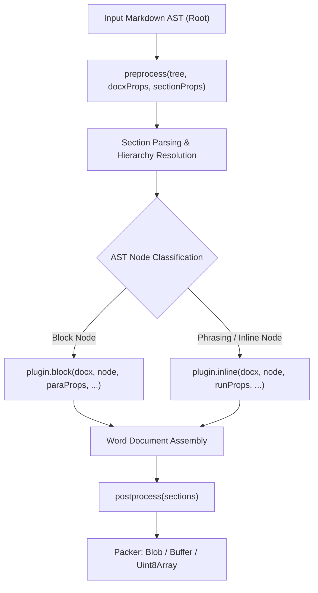

# Authoring Custom Plugins for `@m2d/core`

`@m2d/core` is designed with a lightweight, extensible plugin architecture. Custom plugins allow you to introduce new markdown syntax, alter the AST, or customize how elements render into OpenXML Word structures.

---

## The `IPlugin` Interface

```typescript
import type { IPlugin, Root, EmptyNode } from "@m2d/core";
import type * as docx from "docx";

export interface IPlugin<T extends Node = EmptyNode> {
  /** Modifies or enriches the AST before rendering begins */
  preprocess?: (
    tree: Root,
    docxProps: IDocxProps,
    sectionProps?: ISectionProps,
  ) => void | Promise<void>;

  /** Handles block-level elements (paragraphs, tables, callouts) */
  block?: (
    docxModule: typeof docx,
    node: ExtendedRootContent<T>,
    paraProps: MutableParaOptions,
    blockChildrenProcessor: BlockNodeChildrenProcessor,
    inlineChildrenProcessor: InlineChildrenProcessor,
  ) => (docx.Paragraph | docx.Table)[];

  /** Handles phrasing/inline-level elements (runs, badges, links) */
  inline?: (
    docxModule: typeof docx,
    node: ExtendedPhrasingContent<T>,
    runProps: docx.IRunOptions,
    inlineChildrenProcessor: InlineChildrenProcessor,
  ) => docx.IRun[];

  /** Final cleanup or cache flushing after document packaging */
  postprocess?: (sections: docx.ISectionOptions[]) => void | Promise<void>;
}
```

---

## Plugin Execution Lifecycle



---

## Best Practices for Plugin Authors

1. **Consume Nodes Cleanly**:
   When handling custom nodes in `inline` or `block`, clear `node.type = ""` (or stash it in `node._type`) to signal that your plugin has processed the node.
2. **Use `warnOnce` for Telemetry**:
   Import `warnOnce` from `@m2d/core/utils` to avoid flooding the developer's console when encountering recurring unsupported patterns.
3. **Resilient Error Modes**:
   Never allow an unexpected error to crash the `toDocx` conversion. Provide configurable error strategies (`"warn" | "throw" | "silent"`) and render visible warning badges in Word.
