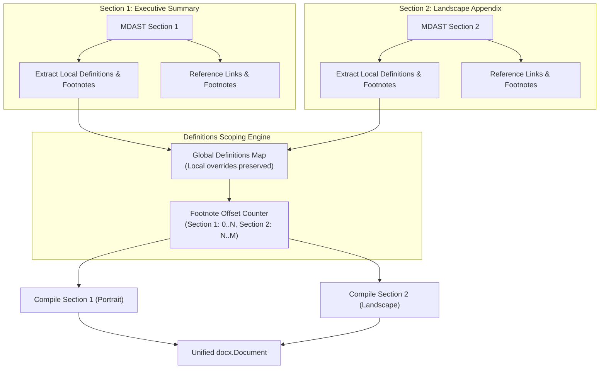

# Sections, Layouts & Heading Hierarchy

`@m2d/core` allows full control over page layout, multi-section documents, page numbering, headers, and footers.

---

## Heading Level Adaptation (`useTitle`)

By default, `@m2d/core` enables `useTitle: true`:
- Top-level Markdown headings (`# Title`, depth 1) map to Word's **Title** style.
- Second-level headings (`## Heading`, depth 2) map to Word's **Heading 1** style.
- Third-level headings (`### Heading`, depth 3) map to Word's **Heading 2** style, and so on.

If you prefer standard 1:1 mapping (where `# Heading` maps directly to Word's **Heading 1**), set:

```typescript
await toDocx(mdast, {}, {
  useTitle: false,
});
```

---

## Multi-Section Documents

> ⚠️ **Deprecation Notice (Next Major Version)**: Passing an array of multiple AST inputs (`{ ast: Root, props?: ISectionProps }[]`) to `toDocx` is deprecated and will be removed in the next major version. In the next major release, multi-section documents will be modeled natively via standard Markdown section directives within a single unified AST.

To define multi-section documents (e.g. landscape appendix, cover page with different margins, multi-chapter books), pass an array of AST section descriptors to `toDocx`:

```typescript
import { toDocx } from "@m2d/core";
import { PageOrientation } from "docx";

const document = await toDocx([
  {
    ast: coverPageAst,
    props: {
      properties: {
        page: {
          margin: { top: 720, bottom: 720, left: 720, right: 720 },
        },
      },
    },
  },
  {
    ast: bodyContentAst,
    props: {
      useTitle: true,
      plugins: [imagePlugin()],
    },
  },
  {
    ast: appendixTableAst,
    props: {
      properties: {
        page: {
          size: {
            orientation: PageOrientation.LANDSCAPE,
          },
        },
      },
    },
  },
]);
```

Each section supports the full range of `docx` `ISectionOptions` properties, including:
- Page margins and paper sizes (A4, Letter, Custom)
- Header and footer definitions
- Page numbering restarts and formats
- Column layouts

---

## Definitions Scope & Reference Management

When converting multi-section documents, Markdown link definitions (`[label]: https://example.com`) and footnotes (`[^note]: Note body`) need clear scoping rules. `@m2d/core` provides the `definitionsScope` configuration option under `IDocxProps`:

```typescript
export type DefinitionsScope = "shared" | "section";

export interface IDocxProps {
  /**
   * Scope of reference link definitions and footnotes across multiple sections.
   * - "shared" (default): Definitions declared in any section are available across all sections.
   * - "section": Definitions are isolated to the section in which they are defined.
   * @default "shared"
   */
  definitionsScope?: DefinitionsScope;
}
```

### Scope Modes Comparison

| Feature / Behavior | `definitionsScope: "shared"` (Default) | `definitionsScope: "section"` |
| :--- | :--- | :--- |
| **Link Definitions Scope** | Global — references declared in Section 3 resolve in Section 1 and 2 | Isolated — references only resolve within the same section |
| **Footnote Scoping** | Global aggregation with collision-free sequential ID offset calculation | Isolated per-section definitions |
| **Collision Resolution** | Local section definition overrides shared definitions on collision | Local section definitions only |
| **Identifier Matching** | Case-insensitive per CommonMark/GFM spec (`UPPERCASE` normalized) | Case-insensitive per CommonMark/GFM spec |
| **Missing References** | Gracefully renders children inline; never throws unhandled errors | Gracefully renders children inline; never throws unhandled errors |

### Multi-Section AST Aggregation Pipeline



### Complete Implementation Example

```typescript
import { toDocx } from "@m2d/core";
import { PageOrientation } from "docx";
import { unified } from "unified";
import remarkParse from "remark-parse";
import remarkGfm from "remark-gfm";

const parser = unified().use(remarkParse).use(remarkGfm);

const section1 = parser.parse(`
# Quarterly Report
Refer to the [System Overview][overview] for details.
Key finding on latency[^latency-note].

[^latency-note]: Observed under peak p99 loads.
`);

const section2 = parser.parse(`
# Performance Topology Matrix
Wide table rendered with landscape dimensions.

| Region | P50 (ms) | P99 (ms) | Availability |
| :--- | :---: | :---: | ---: |
| us-east-1 | 12 | 28 | 99.99% |
| eu-west-1 | 14 | 31 | 99.98% |

Further analysis is in the [System Overview][overview].
`);

const section3 = parser.parse(`
# Appendix & References

[overview]: https://internal.corp/arch/system-overview "Corporate System Overview"
`);

// Compile with shared definitions scope
const docxBlob = await toDocx(
  [
    { ast: section1, props: { page: { size: { orientation: PageOrientation.PORTRAIT } } } },
    { ast: section2, props: { page: { size: { orientation: PageOrientation.LANDSCAPE } } } },
    { ast: section3, props: { page: { size: { orientation: PageOrientation.PORTRAIT } } } },
  ],
  {
    title: "Quarterly Performance Report",
    definitionsScope: "shared", // [overview] resolves across all sections; [^latency-note] gets unique ID 1
  },
);
```
