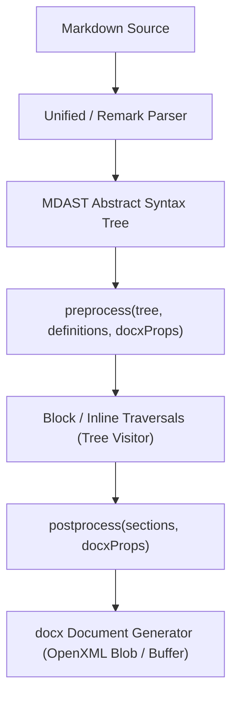

# Plugin Authoring Guide

`md2docx` is built upon an extensible, pluggable architecture. Plugins allow you to intercept Markdown MDAST nodes, define custom OpenXML block or inline formatting (powered by `docx`), inject definitions, or mutate document-level metadata.

---

## 🏗️ Plugin Anatomy

A plugin implements the `IPlugin` interface:

```typescript
import type { IPlugin, DocxProps } from "@m2d/core";
import type { Root, Node } from "mdast";

export const myPlugin = (options?: MyOptions): IPlugin => {
  return {
    name: "my-plugin",

    // 1. AST & Metadata Preprocessing
    preprocess: async (tree: Root, definitions: Map<string, Node>, docxProps: DocxProps) => {
      // Traverse or mutate the MDAST tree, collect definitions, or set docxProps
    },

    // 2. Block-Level Node Handlers (e.g., custom callout blocks, custom charts)
    block: {
      callout: async (node, context) => {
        // Return docx Paragraph, Table, or BlockElement array
      },
    },

    // 3. Inline-Level Node Handlers (e.g., mentions, badges, tags)
    inline: {
      mention: (node, context) => {
        // Return docx TextRun or RunElement array
      },
    },

    // 4. Post-processing Hook (runs after document sections are generated)
    postprocess: async (sections, docxProps) => {
      return sections;
    },
  };
};
```

---

## 🔄 Lifecycle Hooks

The compilation lifecycle executes plugins in a predictable, multi-pass sequence:



### 1. `preprocess(tree, definitions, docxProps)`
Runs before node-to-OpenXML compilation begins.
- **`tree`**: The root MDAST syntax tree. You can inspect, rewrite, or prune nodes using `unist-util-visit`.
- **`definitions`**: Map of reference identifiers (links, footnotes, citations).
- **`docxProps`**: Document metadata properties (e.g., `title`, `subject`, `creator`, `keywords`). Any modifications here persist to the generated Word document package properties.

> [!NOTE]
> The legacy `root(tree, definitions)` hook is deprecated in favor of `preprocess(tree, definitions, docxProps)`.

---

## 🛠️ Step-by-Step: Creating a Custom Callout Plugin

Here is a practical, production-ready example of a custom Callout Block plugin:

```typescript
import type { IPlugin } from "@m2d/core";
import { Paragraph, TextRun, Table, TableRow, TableCell, BorderStyle, WidthType } from "docx";
import { visit } from "unist-util-visit";

export interface CalloutOptions {
  borderColor?: string;
  backgroundColor?: string;
}

export const calloutPlugin = (options: CalloutOptions = {}): IPlugin => {
  const borderColor = options.borderColor ?? "2563EB";
  const backgroundColor = options.backgroundColor ?? "F8FAFC";

  return {
    name: "custom-callout",

    // Step A: Rewrite MDAST blockquote nodes marked with [!NOTE] into custom 'callout' nodes
    preprocess: async (tree) => {
      visit(tree, "blockquote", (node: any) => {
        const firstParagraph = node.children?.[0];
        const firstText = firstParagraph?.children?.[0];

        if (firstText?.type === "text" && firstText.value.startsWith("[!NOTE]")) {
          // Strip prefix
          firstText.value = firstText.value.replace(/^\[!NOTE\]\s*/, "");
          // Change AST type so our custom block handler catches it
          node.type = "callout";
          node.data = { variant: "note" };
        }
      });
    },

    // Step B: Render 'callout' AST nodes into a single-cell OpenXML Table with left accent border
    block: {
      callout: async (node, context) => {
        // Recursively convert children nodes into docx elements
        const childElements = await context.visitChildren(node);

        return new Table({
          width: { size: 100, type: WidthType.PERCENTAGE },
          rows: [
            new TableRow({
              children: [
                new TableCell({
                  shading: { fill: backgroundColor },
                  borders: {
                    top: { style: BorderStyle.NONE },
                    bottom: { style: BorderStyle.NONE },
                    right: { style: BorderStyle.NONE },
                    left: { style: BorderStyle.SINGLE, size: 24, color: borderColor },
                  },
                  margins: { top: 140, bottom: 140, left: 200, right: 200 },
                  children: childElements as Paragraph[],
                }),
              ],
            }),
          ],
        });
      },
    },
  };
};
```

---

## 🏷️ Step-by-Step: Creating an Inline Element Plugin

To render special inline elements (such as user mentions `@username` or badges):

```typescript
import type { IPlugin } from "@m2d/core";
import { TextRun } from "docx";
import { findAndReplace } from "mdast-util-find-and-replace";

export const mentionPlugin = (): IPlugin => {
  return {
    name: "user-mentions",

    preprocess: async (tree) => {
      findAndReplace(tree, [
        [/@([a-zA-Z0-9_-]+)/g, (_match: string, username: string) => {
          return {
            type: "mention",
            value: username,
            data: { username },
          };
        }],
      ]);
    },

    inline: {
      mention: (node) => {
        return new TextRun({
          text: `@${node.value}`,
          bold: true,
          color: "2563EB",
          shading: { fill: "EFF6FF" },
        });
      },
    },
  };
};
```

---

## 🔌 Registering Your Plugins

You can register your custom plugins anywhere `md2docx` or remark pipelines are consumed:

```typescript
import { md2docx } from "@m2d/md2docx";
import { calloutPlugin } from "./callout-plugin";
import { mentionPlugin } from "./mention-plugin";

const docxBlob = await md2docx(markdownText, {
  plugins: [
    calloutPlugin({ borderColor: "059669", backgroundColor: "ECFDF5" }),
    mentionPlugin(),
  ],
});
```

---

## 💡 Best Practices

1. **Avoid Mutating Untracked State**: Always keep plugin handlers stateless across compilation cycles. Pass configurations via factory parameters.
2. **Respect `context.visitChildren`**: When handling container blocks (e.g. callouts, custom divs), delegate child rendering to `context.visitChildren(node)` to allow nested lists, bolding, code runs, and links to resolve properly.
3. **Use Arrow Functions**: Consistent modern ES conventions make plugins easily bundlable and tree-shakeable in both ESM and CJS environments.
