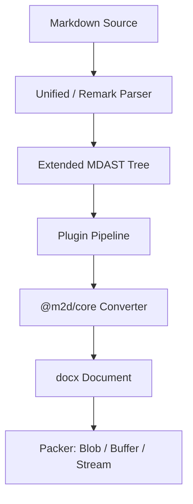
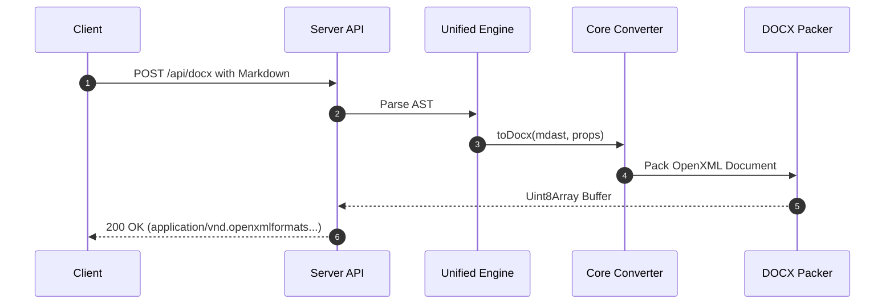
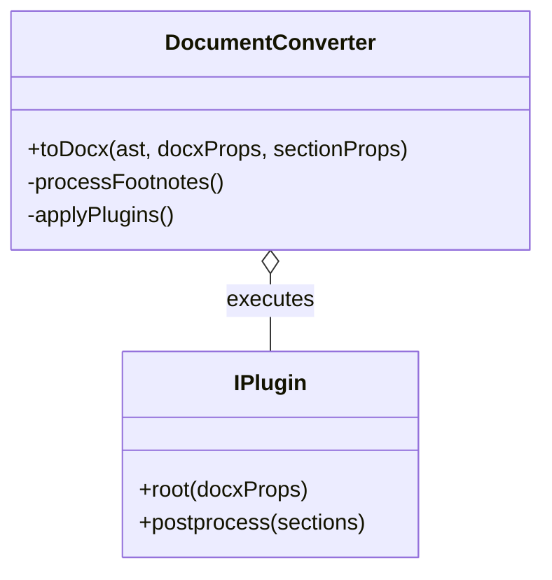
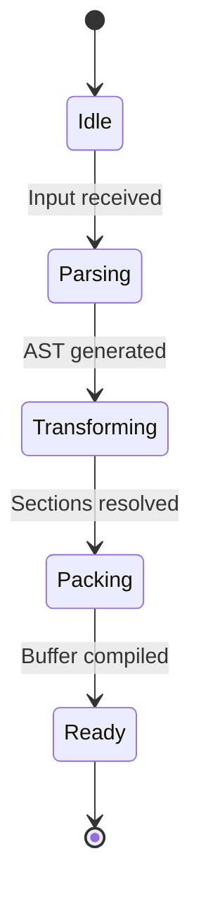
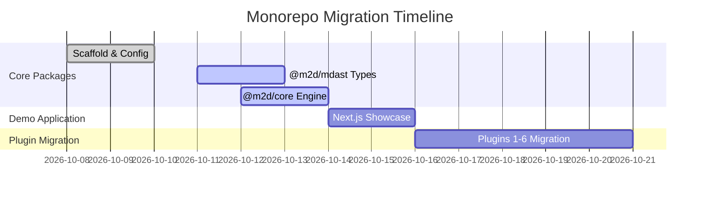
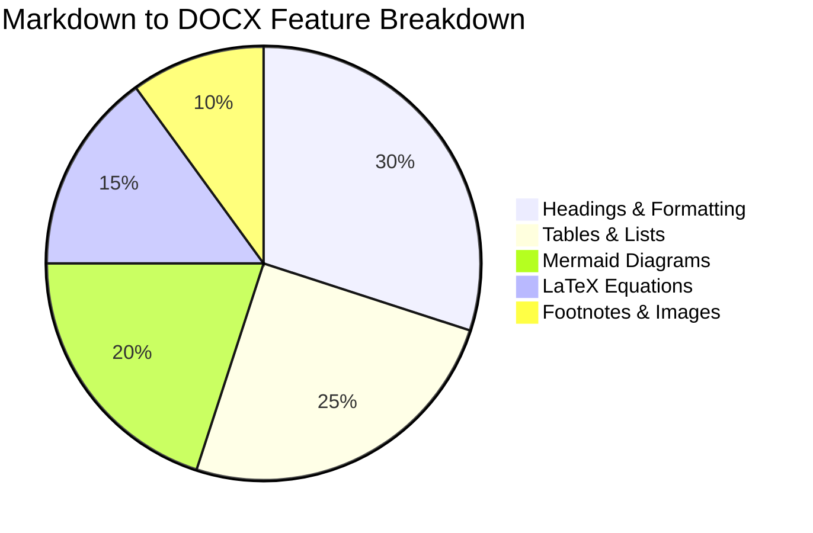
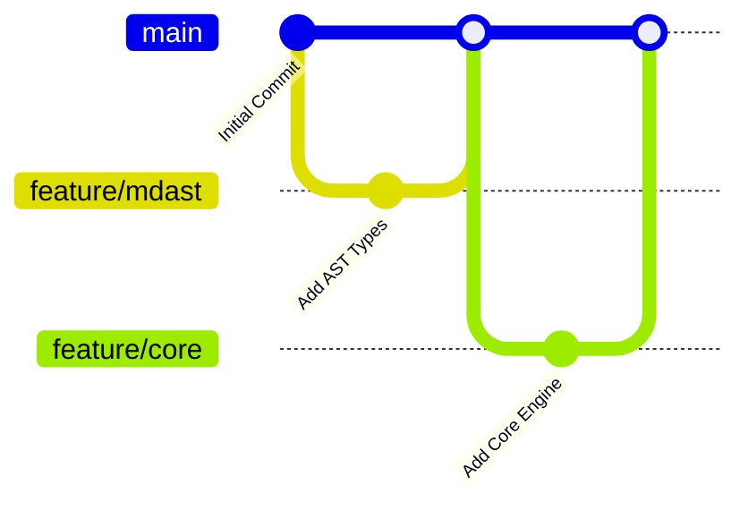
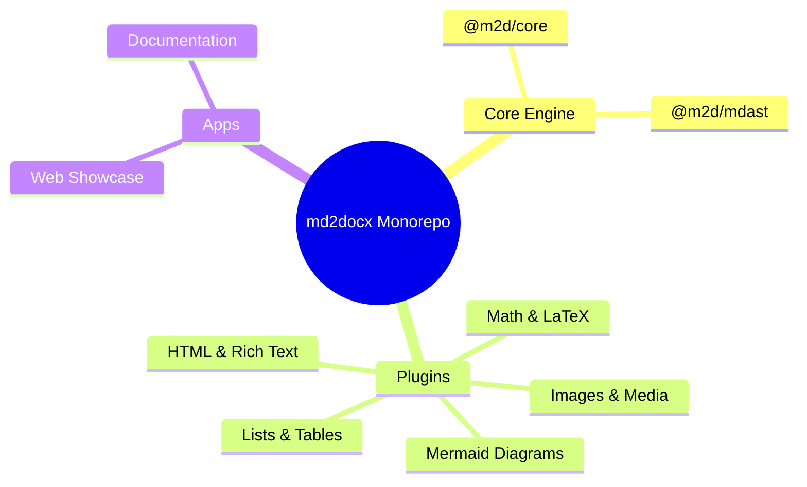
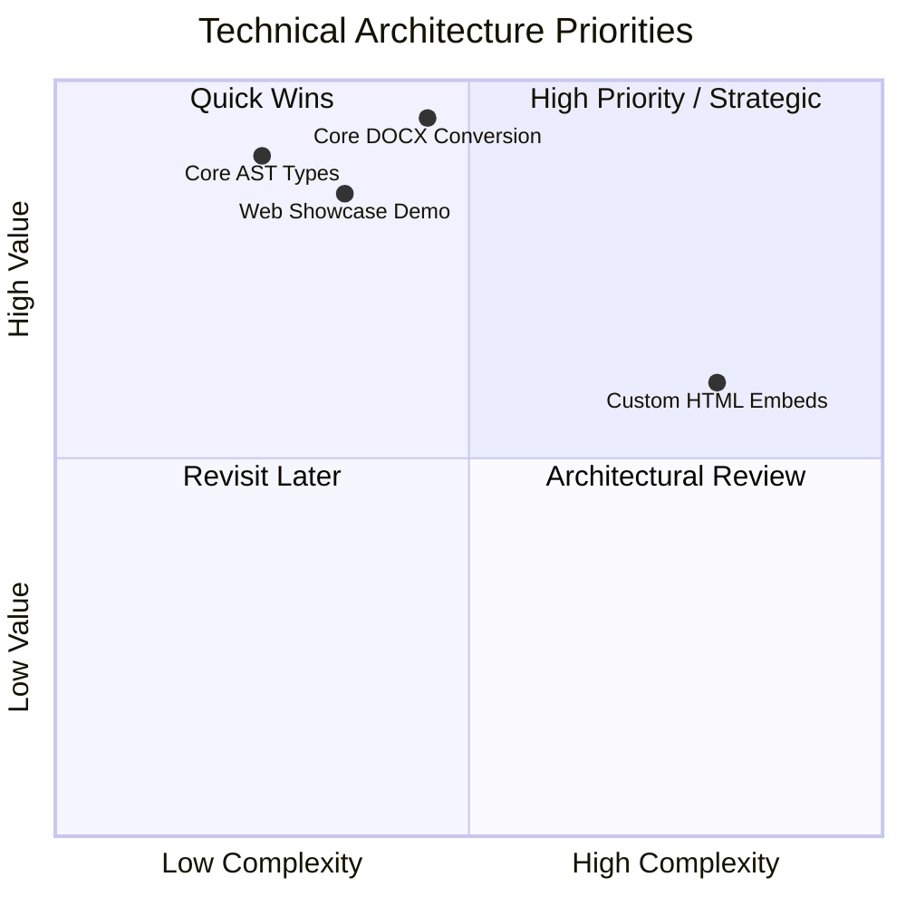

# Markdown Syntax Showcase

A comprehensive living document showcasing standard Markdown, GitHub Flavored Markdown (GFM), math, diagrams, tables, and HTML extensions converted into DOCX.

## Table of Contents
- [1. Basic Elements](#1-basic-elements)
  - [Headings](#headings)
  - [Text Formatting](#text-formatting)
  - [Blockquotes](#blockquotes)
  - [Horizontal Rules](#horizontal-rules)
- [2. Lists](#2-lists)
  - [Unordered Lists](#unordered-lists)
  - [Ordered Lists](#ordered-lists)
  - [Nested Lists](#nested-lists)
  - [Mixed Lists](#mixed-lists)
  - [Complex Hierarchies](#complex-hierarchies)
- [3. Code Blocks](#3-code-blocks)
  - [JavaScript / TypeScript](#javascript--typescript)
  - [Python](#python)
  - [JSON](#json)
- [4. Tables](#4-tables)
  - [Standard GFM Table](#standard-gfm-table)
  - [Column Alignments](#column-alignments)
  - [Multi-line and Formatted Cells](#multi-line-and-formatted-cells)
  - [Nested HTML Tables](#nested-html-tables)
- [5. Links and Images](#5-links-and-images)
  - [Hyperlinks](#hyperlinks)
  - [Reference Links](#reference-links)
  - [Images (SVG, PNG, Data URLs)](#images)
  - [HTML Images with Styling](#html-images-with-styling)
- [6. Task Lists (GFM)](#6-task-lists-gfm)
- [7. Footnotes](#7-footnotes)
- [8. Emojis (GFM)](#8-emojis-gfm)
- [9. Math Equations (KaTeX / LaTeX)](#9-math-equations-katex--latex)
  - [Inline Math](#inline-math)
  - [Display Equations](#display-equations)
  - [Matrices and Alignments](#matrices-and-alignments)
- [10. Diagrams (Mermaid)](#10-diagrams-mermaid)
  - [Flowcharts](#flowcharts)
  - [Sequence Diagrams](#sequence-diagrams)
  - [Class Diagrams](#class-diagrams)
  - [State Diagrams](#state-diagrams)
  - [Gantt Charts](#gantt-charts)
  - [Pie Charts](#pie-charts)
  - [Git Graphs](#git-graphs)
  - [Mindmaps](#mindmaps)
  - [Quadrant Charts](#quadrant-charts)
- [11. Definition Lists](#11-definition-lists)
- [12. Admonitions & Callouts](#12-admonitions--callouts)
- [13. HTML Elements](#13-html-elements)
  - [Inline Formatting & Badges](#inline-formatting--badges)
  - [Embedded HTML Components](#embedded-html-components)

---

## 1. Basic Elements

### Headings

# Heading 1
## Heading 2
### Heading 3
#### Heading 4
##### Heading 5
###### Heading 6

### Text Formatting

You can emphasize text using **bold**, *italic*, ***bold and italic***, ~~strikethrough~~, `inline code`, and ==highlighted text==.

- **Bold text**: `**bold**` or `__bold__`
- *Italic text*: `*italic*` or `_italic_`
- ***Bold and Italic***: `***bold and italic***`
- ~~Strikethrough~~: `~~strikethrough~~`
- Subscript: H~2~O
- Superscript: X^2^
- Underlined: <u>Underlined text</u>

### Blockquotes

> "The Markdown to DOCX engine preserves formatting, layout hierarchy, and typographic fidelity across multiple document sections."
>
> — *md2docx Design Philosophy*

Nested blockquote:
> Outer quote level 1
>> Nested quote level 2
>>> Deeply nested quote level 3

### Horizontal Rules

Three or more hyphens, asterisks, or underscores:

---

## 2. Lists

### Unordered Lists

- Primary Item Alpha
  - Sub-item Alpha-1
  - Sub-item Alpha-2
- Primary Item Beta
- Primary Item Gamma

### Ordered Lists

1. First milestone: Requirement Analysis
2. Second milestone: Monorepo Architecture Setup
3. Third milestone: Multi-package Build & Test Pipeline
4. Fourth milestone: End-to-end Showcase Deployment

### Nested Lists

- Fruits
  - Apple
    - Honeycrisp Apple
    - Granny Smith Apple
  - Citrus
    - Valencia Orange
    - Meyer Lemon
- Vegetables
  - Root
    - Carrot
    - Radish
  - Leafy
    - Spinach
    - Kale

### Mixed Lists

1. Project Phases
   - Planning
     - Requirements gathering
     - Timeline estimation
   - Execution
     - Core engine migration
     - Plugin integration
2. Release & Delivery
   - Documentation
   - NPM Package Publishing

### Complex Hierarchies

#### 🗂 Project Roadmap
- Q1 Goals:
  1. Engine Modernization
     - Tree-shaking support
     - Pure ESM & CJS dual exports
  2. Performance Optimization
     - Fast AST traversal
     - Caching for repeated transforms
- Q2 Goals:
  1. Extended Plugin Ecosystem
     - Native MathML rendering
     - Vector SVG to EMF/WMF embedding

---

## 3. Code Blocks

### JavaScript / TypeScript

```typescript
import { toDocx } from "@m2d/core";
import { unified } from "unified";
import remarkParse from "remark-parse";

export async function convertMarkdown(md: string): Promise<Blob> {
  const tree = unified().use(remarkParse).parse(md);
  return await toDocx(tree, {
    title: "Executive Report",
    creator: "md2docx Engine",
  });
}
```

### Python

```python
def transform_ast(node):
    """Recursively process AST nodes."""
    if not node:
        return None
    for child in node.get("children", []):
        transform_ast(child)
    return node
```

### JSON

```json
{
  "name": "@m2d/core",
  "version": "1.7.1",
  "license": "MIT",
  "engine": "docx"
}
```

---

## 4. Tables

### Standard GFM Table

| Package | Purpose | Category | Status |
| :--- | :--- | :---: | ---: |
| `@m2d/core` | Core MDAST to DOCX engine | Engine | Stable |
| `@m2d/mdast` | Extended AST type declarations | Types | Stable |
| `@m2d/html` | Raw HTML to MDAST nodes | Plugin | Active |
| `@m2d/image` | Image download & embedding | Plugin | Active |
| `@m2d/table` | Advanced table formatting | Plugin | Active |

### Column Alignments

| Left Aligned | Centered Content | Right Aligned |
| :----------- | :--------------: | ------------: |
| Item Alpha   |       42         |      \$19.99 |
| Item Beta    |      128         |     \$149.50 |
| Item Gamma   |     1024         |   \$1,200.00 |

### Multi-line and Formatted Cells

| Metric | Details | Target |
| :--- | :--- | :--- |
| Test Coverage | Unit test coverage for AST conversions.<br>- Core Engine: >95%<br>- Plugin modules: >90% | **95%** |
| Bundle Size | Pure tree-shakeable dual ESM/CJS build.<br><em>Optimized with esbuild/tsup</em> | **< 10KB** |

### Nested HTML Tables

> Embedded HTML table within a blockquote:
>
> <table border="1" style="width: 100%; border-collapse: collapse;">
>   <thead>
>     <tr style="background-color: #f3f4f6;">
>       <th style="padding: 8px;">Feature</th>
>       <th style="padding: 8px;">Support</th>
>       <th style="padding: 8px;">Notes</th>
>     </tr>
>   </thead>
>   <tbody>
>     <tr>
>       <td style="padding: 8px;">Standard Markdown</td>
>       <td style="padding: 8px;">Full</td>
>       <td style="padding: 8px;">CommonMark compliant</td>
>     </tr>
>     <tr>
>       <td style="padding: 8px;">GFM Extensions</td>
>       <td style="padding: 8px;">Full</td>
>       <td style="padding: 8px;">Tables, task lists, strikethrough, autolinks</td>
>     </tr>
>   </tbody>
> </table>

---

## 5. Links and Images

### Hyperlinks

- [md2docx GitHub Repository](https://github.com/md2docx/md2docx)
- [Official Documentation](https://md2docx.com)
- Autolink: <https://github.com/md2docx/md2docx>
- Email Link: <mailto:contact@mayankchaudhari.com>

### Reference Links

Here is a [reference link to docx][docx-library] and a [reference link to remark][remark-js].

[docx-library]: https://docx.js.org
[remark-js]: https://remark.js.org

### Images

SVG Vector Image:


PNG Bitmap Image:


Base64 Data URL Image:


### HTML Images with Styling

<p align="center">
  
</p>

---

## 6. Task Lists (GFM)

- [x] Initial monorepo scaffolding
- [x] Canonical aliases and package metadata definition
- [x] Foundation AST types (`@m2d/mdast`)
- [x] Core engine implementation (`@m2d/core`)
- [ ] Plugin conversions:
  - [ ] `@m2d/html`
  - [ ] `@m2d/list`
  - [ ] `@m2d/table`
  - [ ] `@m2d/image`
  - [ ] `@m2d/math`
  - [ ] `@m2d/mermaid`
- [ ] End-to-end interactive demo in `apps/web`

---

## 7. Footnotes

Here is a statement requiring citation[^1], and another detail requiring clarification[^2].

Long footnote example with multiple paragraphs[^3].

[^1]: Footnote 1: The conversion is powered by OpenXML and the docx library.
[^2]: Footnote 2: Performance remains under 100ms for standard 20-page documents.
[^3]: Footnote 3: Footnotes can contain multiple paragraphs.

    Subsequent paragraph inside the footnote definition demonstrating indented content blocks.

---

## 8. Emojis (GFM)

:rocket: :sparkles: :fire: :white_check_mark: :art: :wrench: :memo: :zap: :package: :tada:

---

## 9. Math Equations (KaTeX / LaTeX)

### Inline Math

The Pythagorean theorem is defined as $a^2 + b^2 = c^2$. Einstein's energy-mass equivalence is $E = mc^2$.

### Display Equations

$$
\int_{-\infty}^{\infty} e^{-x^2} dx = \sqrt{\pi}
$$

Euler's identity:
$$
e^{i\pi} + 1 = 0
$$

Quadratic formula:
$$
x = \frac{-b \pm \sqrt{b^2 - 4ac}}{2a}
$$

### Matrices and Alignments

$$
\begin{pmatrix}
1 & 0 & 0 \\
0 & 1 & 0 \\
0 & 0 & 1
\end{pmatrix}
$$

$$
\begin{aligned}
f(x) &= (x + 3)^2 \\
     &= x^2 + 6x + 9
\end{aligned}
$$

---

## 10. Diagrams (Mermaid)

### Flowcharts



### Sequence Diagrams



### Class Diagrams



### State Diagrams



### Gantt Charts



### Pie Charts



### Git Graphs



### Mindmaps



### Quadrant Charts



---

## 11. Definition Lists

Term 1
: Definition 1 explaining the concept in detail.

Unified / Remark
: Ecosystem for parsing, transforming, and compiling structured syntax trees.

DOCX
: XML-based Open Packaging Convention file format used by Microsoft Word.

---

## 12. Admonitions & Callouts

> [!NOTE]
> This is an informative callout highlighting important context or reference links.

> [!TIP]
> Use targeted plugins rather than loading unnecessary dependencies to maintain minimal bundle sizes.

> [!IMPORTANT]
> The `toDocx` function returns a Promise and accepts output format targets: `"blob"`, `"buffer"`, or `"arraybuffer"`.

> [!WARNING]
> Ensure remote images use accessible and secure HTTPS URLs when embedding in documents.

> [!CAUTION]
> Avoid circular references when deeply augmenting custom unist nodes.

---

## 13. HTML Elements

### Inline Formatting & Badges

You can use raw HTML tags such as:
- <kbd>Ctrl</kbd> + <kbd>C</kbd> / <kbd>Cmd</kbd> + <kbd>Shift</kbd> + <kbd>P</kbd>
- <mark style="background-color: #fef08a; padding: 2px 6px; border-radius: 4px;">Highlighted text with background</mark>
- Status: <span style="color: #16a34a; font-weight: bold;">● Active</span> / <span style="color: #dc2626; font-weight: bold;">■ Inactive</span>

### Embedded HTML Components

<details>
  <summary><strong>Click to expand advanced technical details</strong></summary>
  
  <p>The core converter iterates through the Markdown AST, converts phrasing elements to docx <code>TextRun</code> instances, groups block content into <code>Paragraph</code> instances, and organizes sections into a <code>Document</code>.</p>
</details>

---

<p align="center"><em>Markdown Syntax Showcase — Prepared for md2docx Monorepo</em></p>
